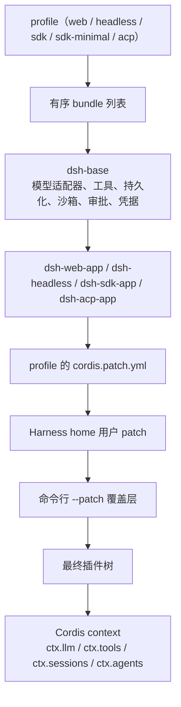

## 项目速览（TL;DR）

DeepSeek Harness（命令行 `dsh`）是 DeepSeek AI 开源的 Agent 框架，核心主张只有一句：**everything is a plugin**——模型适配器、工具注册表、会话日志、沙箱策略，连 Agent 主循环本身都是插件，都能从配置里换掉。它建立在自研（vendored）的插件框架 Cordis 之上，Cordis 的设计对应论文 *A Programming Paradigm for Spatiotemporal Composability*。

| 项目 | 数据 |
|------|------|
| Star 数 | 254,429（2026-10-20 查询） |
| Forks | 30,749 |
| 许可证 | MIT |
| 主要语言 | TypeScript（另有 Python SDK） |
| 首次提交 | 2026-08-13 |
| 最近推送 | 2026-10-17 |
| 版本 | `0.2.1-rc.2`（developer preview） |
| 学术支撑 | Cordis 论文（arXiv 2608.25512） |

**一句话结论：** 如果你想读一套把「可组合性」做到极致的 Agent 框架源码，值得投入时间；如果你想现在就拿它做生产环境的稳定底座，建议再等等——它自己声明会有破坏性变更。

> **信息来源：** GitHub 仓库元数据、`README.md`、根目录 `package.json`

## 为什么存在？（Why）

当下主流 Agent 框架的问题不是「能力不够」，而是「改不动」。

大多数框架有一个隐式的特权内核：主循环、会话存储、工具调度写死在核心代码里，接入方只能用 hook 或中间件在外围打补丁。这带来几个具体痛点：

| 场景 | 常见框架 | dsh 的主张 |
|------|----------|-----------|
| 换模型供应商 | 继承某个 BaseModel 类，或在配置文件里选枚举值 | 注册一个适配器到 `ctx.llm`，整条链路随之切换 |
| 改主循环行为 | 改分叉版本，或等待上游合并 hook | 卸载默认 `agent-loop`，挂载自己的实现 |
| 换会话存储 | 通常只能落 JSON 文件或数据库二选一 | 实现 `SessionPersistence` 接口即可替换后端 |
| 移除插件 | 重启进程，残留注册项 | 注册即 effect，卸载时自动反向回收 |
| 多人协作扩展 | 各家 fork 自己的内核 | 所有扩展在同一个 context 上平级挂载 |

核心洞察是：**如果每项能力都是一个带接口定义（Service Definition）、实现（Service Provider）、消费者（Consumer）的「能力接缝」（capability seam），那么替换一个 provider 就能改变整个产品的行为。** 项目文档举的例子很能说明问题：文件系统与子进程 provider 共享同一个「执行世界」，所以把它们一起指向远程沙箱时，Bash、PTY、LSP 会跟着一起搬过去，不需要 fork 任何 provider。

> **信息来源：** `docs/architecture.md`（Capability seams 一节）、`docs/cordis-primer.md`

## 架构与设计（How）

### 整体分层

一次 `dsh` 启动，本质是「用有序图层组装出一棵插件树」：



关键设计是 patch 的作用方式：patch 按 `id` 定位某一行配置并**整体替换其 config**，或插入新行；图层优先级自下而上，越靠后越能覆盖前面的声明。所以官方 bundle 不是特权的「正确实现」，只是第一层默认值。任何一行都可以被用户 patch 掉——`dsh --profile web --dump-config` 打印出来的每一行，都是可替换的。

`dsh-sdk-minimal` 是个刻意的例外：它不加载 `dsh-base`，一个 bundle 独占完整的显式 SDK 树，用来验证「不用共享基座也能组装出产品」。

> **信息来源：** `docs/architecture.md`（Profiles and bundles 一节）

### 模块职责

| 包 | 负责 | `ctx` 键 |
|---|---|---|
| `core/session` | 只追加的 `SessionEvent` 日志与内存存储 | `ctx.sessions` |
| `core/system-prompt` | prompt 分节与工具 schema 组装 | `ctx.systemPrompt` |
| `core/tools` | 作用域化工具注册表与带校验的执行管线 | `ctx.tools` |
| `core/agent` | `Agent` 接口、活体注册表、`agent/*` 事件 | `ctx.agents` |
| `core/agent-loop` | 实现该接口的默认驱动器 | `ctx.agentLoop` |
| `llm/llm` | 消息与流式词表、适配器接缝 | `ctx.llm` |

`agent-loop` 只是一个实现了 `Agent` 接口的默认插件，而不是框架的地基。这一点决定了它的可替换性是结构性的，而非营销话术。

> **信息来源：** `docs/architecture.md`（Core packages 一节）

### 核心模块解读一：工具执行管线

这是全项目最值得学习的部分。一个工具调用在 `tools/pre-execute` 与 `tools/post-execute` 两道 waterfall 之间穿行，中途依次经过：单调守卫（monotonic guards，只允许 deny 或弃权，不可被后续策略翻案）、一次性审批 `ctx.approval`、环绕式 `tools/execute`（超时、重试、指标注入）、工具本体、`fs/*` 写意图事件、内容投影与最终内容校验。

| 阶段 | 职责 | 谁扩展 |
|------|------|--------|
| `tools/pre-execute` | 钩子、权限、沙箱决策，可改参数 | 策略插件 |
| 单调守卫 | 只 deny 或弃权，身份受保护 | 所有者策略 |
| `ctx.approval` | 单次授权；不可问即拒绝 | 审批 provider |
| `tools/execute` | 环绕派发，包超时与重试 | 可观测性插件 |
| 工具 `execute()` | 只返回 canonical JSON | 工具作者 |
| `fs/*-intent` | 文件系统写前检查（含 read-before-edit） | fs provider |
| `tools/post-execute` | 接受、阻断、替换、追加上下文 | 结果改写插件 |
| `tools/result` | 同步通知，冻结后的最终结果 | 遥测与 UI |

这里有个很克制的设计取舍：**工具本体只能返回一个符合 `output.schema` 的 canonical JSON 值，不能自己拼 content block**。渲染成模型可见内容、渲染成 UI 卡片、持久化成可回放元数据，三件事被拆成 `output.render`、`presentResult`、`output.presentationMeta` 三个纯函数。好处是同一个工具在三处入口（主模型、子调用、回放）看到的语义永远一致；代价是写工具时会觉得「啰嗦」，但换来的是不可变性与可测试性。

失败语义也很干脆：`execute` 抛错，或返回不符合 schema 的值，一律收敛成 `isError`。业务上的「不理想但成功」（例如进程非零退出）应当编码进 canonical 值里，而不是伪装成异常。

安全上还有一条细节：注册表会在策略介入前，一次性把模型给的 `arguments` 深拷贝成 detached lossless JSON 并冻结，随后发放不可变的 `exec.token`。策略层想改参数，只能通过 around 派发拿到可变视图——这堵住了「钩子偷偷篡改已审计参数」的路径。

> **信息来源：** `docs/tool-execution-pipeline.md`、`docs/cookbook/adding-a-tool.md`

### 核心模块解读二：会话日志即事实来源

dsh 的会话不是一个对象，而是一个**只追加的 typed event log**。模型看到的 message history 不是存下来的，而是每次从日志里 `deriveMessages()` 投影出来的。

这条约束被写成了项目铁律：**model-visible means logged**。任何要进入模型请求的内容，都必须先有对应的 session event。于是 fork、resume、transcript、telemetry、持久化五条链路全部从同一批持久事实派生，天然一致。

事件分三个域，选错域是多数改动的第一道坑：

- **Session 事件**：持久事实，写入日志并经 `session/event` 广播，用于必须在重载后存活的信息。
- **Agent 事件**（`agent/*`）：携带活体 `Agent`，用于观察或拦截进行中的工作，如 inbox、step、status。
- **能力事件**（`fs/*`、`tools/*`、`telemetry/*`）：为接缝挂策略与适配器，无需 import 主循环。

持久化格式的演进策略也值得一提：JSONL 从 v0 演进到 v1+，文件名带版本号（`session.vN.jsonl`，支持 zstd），已提交的代际路径**永不重命名、替换或删除**；迁移是一次性的静态链，读取旧版本时在内存里解码到当前逻辑格式，写入时才发布一个新的、版本命名的后继文件。这是典型的「只增不改」事件溯源落地方式。

> **信息来源：** `docs/architecture.md`（Events / Session log 一节）、`docs/subsystems/session.md`

### Cordis 的五个概念

读懂 dsh 之前必须先读懂 Cordis，而 Cordis 只需要五个概念：

| 概念 | 含义 | 在 dsh 里的体现 |
|------|------|----------------|
| Plugin | 实现 `Service` 的对象，可以是带 `apply(ctx)` 的函数 | 一个工具、一个适配器 |
| Context | service 的仓库，用稳定 key 认领 | `ctx.tools`、`ctx.llm` |
| inject | 声明依赖，由框架等待就绪 | `export const inject = ['tools']` |
| Event | 类型化事件，五种派发模式 | `emit` / `waterfall` / `parallel` / `serial` / `bail` |
| Effect | 注册即可逆副作用 | `ctx.effect()` 返回 disposer |

其中最需要理解的是 **waterfall**：它是「环绕中间件」，监听器签名是 `(...args, next)`，调用 `next()` 表示把（可能已被包裹的）结果委托给下一个监听器，不调用则短路。对单决策事件，短路就是设计意图——策略监听器拿到决策权时直接返回；只想观察的监听器必须委托。

由于注册即 effect，一切的回收都是自动的：卸载插件时，它注册的 prompt 分节、工具 schema、适配器、监听器会按预期顺序反向解绑。这就是「无需重启即可替换能力」的底层机制。

> **信息来源：** `docs/cordis-primer.md`

## 快速上手

### 安装与启动

```bash
# 需要 Node.js 22.19+ 或 24+
npx @deepseek-ai/dsh web
```

默认在 `http://127.0.0.1:3080` 启动 Web UI 并打开浏览器；通过 SSH 启动时只打印宿主机 URL（本地转发地址归 SSH 客户端持有）。加 `--no-open` 则只起服务。

从源码运行：

```bash
git clone https://github.com/deepseek-ai/deepseek-harness.git
cd deepseek-harness
pnpm install
pnpm run build
pnpm dsh web
```

### 写第一个插件

一个插件就是一个导出 `apply` 的 TypeScript 模块。下面这个例子注册了一个模型可调用的 `greet` 工具：

```ts
import type { Context } from '@deepseek-ai/cordis'
import { defineTool } from '@deepseek-ai/dsh-tools'

export const name = 'greet-tool'
export const inject = ['tools']

export function apply(ctx: Context) {
  ctx.tools.register(defineTool({
    name: 'greet',
    description: 'Greet someone by name.',
    parameters: {
      name: { type: 'string', required: true, description: 'The name to greet' },
    },
    output: {
      schema: { type: 'string' },
      render: (_args, value) => [{ type: 'text', text: value }],
    },
    async execute(args) {
      return `Hello, ${args.name}!`
    },
  }))
}
```

`inject` 让 Cordis 等到工具注册表就绪再加载本插件；`defineTool` 从 `parameters` 推导并校验 `args` 类型；`execute` 只返回 canonical 值，`output.render` 负责把它变成模型可见内容。注册同样是 effect——插件卸载时工具自动注销。

### 用 patch 覆盖层挂载

在仓库根目录建一个 `scratch-plugin/cordis.yml`，注意插件路径必须是绝对路径：

```yaml
- insert:
    - id: greet
      name: '/absolute/path/to/deepseek-harness/scratch-plugin/src/my-plugin.ts'
```

然后用覆盖层启动：

```bash
pnpm dsh web --patch ./scratch-plugin/cordis.yml
```

### 常见配置点

| 配置项 | 说明 |
|--------|------|
| `--profile` | 选择 `web`、`headless`、`sdk`、`sdk-minimal`、`acp` |
| `--patch` | 追加一个 patch 覆盖层，可多次出现 |
| `--dump-config` | 打印当前 profile 组装的完整插件行，便于定位可替换项 |
| `--no-open` | 只启动服务，不打开浏览器 |
| `$DSH_HOME` | Harness 主目录，存放 profile、已装插件与用户 patch |

> **信息来源：** `README.md`、`docs/user/develop/basic/index.md`、`docs/user/develop/basic/tool.md`、`docs/architecture.md`

## 横向对比

| 维度 | DeepSeek Harness | Claude Code 类 CLI 工具 | 通用 Agent 框架 |
|------|------------------|------------------------|----------------|
| 定位 | 可组装的 Agent 运行时 | 开箱即用的编码助手 | 应用层编排库 |
| 启动成本 | 一条 `npx` 命令 | 一条命令 | 需写业务代码 |
| 可定制深度 | 主循环、存储、工具全可换 | 受限于 hook 与子代理 | 通常限于工具与 prompt |
| 学习曲线 | 陡，需理解 Cordis 五个概念 | 平缓 | 中等 |
| 卸载与回滚 | 注册即 effect，可逆 | 无此概念 | 视框架而定 |
| 扩展生态 | `dsh-plugin` topic，第三方桌面端等已涌现 | 官方生态为主 | 依赖社区 |
| 稳定性 | developer preview，明确会破坏兼容 | 相对稳定 | 因项目而异 |
| 安全模型 | 沙箱 + 审批 + 单调守卫分层 | 依赖宿主权限 | 多为自行实现 |

差异的本质在「可变性层级」：通用 Agent 框架允许你在自己的应用里换工具、换 prompt；dsh 允许你在**框架内部**换掉主循环和存储后端。这既是它最锋利的地方，也是它最不适合新手的理由——它的抽象是为「长期演进的产品」准备的，不是为「三天出个 demo」准备的。

> **信息来源：** 各项目 README 与公开文档；对比维度依据 dsh 的 `docs/architecture.md`

## 使用建议与风险评估

### ✅ 推荐场景

- 需要在多个模型供应商、多种执行环境（本地、SSH、远程沙箱）之间切换的产品
- 企业内需要把 Agent 嵌进已有系统，且对会话持久化有自定义要求
- 想研究「可组合 Agent 架构」的工程师，这套源码实现了罕见的完整度
- 需要桌面端与 Web 端共用同一套运行时的团队

### ❌ 不推荐场景

- 生产关键路径：目前是 developer preview，官方明确声明会有破坏性变更
- 小团队快速验证想法：Cordis 的学习成本会先吃掉一周
- 只需要一个能聊天的编码助手：直接用成熟的 CLI 工具更划算

### ⚠️ 已知风险

- **安全**：项目 `SAFETY.md` 明确说明未经过安全审计，不应被视为安全或可用于生产；沙箱与审批只能降低风险，不能保证隔离。官方建议在一次性虚拟机或容器中运行，并先审查插件与将要执行的命令。
- **外部贡献受限**：`CONTRIBUTING.md` 说明当前不接受外部 pull request，反馈走 GitHub Discussions。这意味着改代码只能 fork 或写插件。
- **文档密度高**：`docs/` 下的架构文档极其详尽，但也意味着信息密度大，需要按 primer、architecture、subsystems 的顺序读。
- **合规提醒**：文档与 AI 水平问题请以官方文档为准，论文结论需自行验证。

### 🔮 未来展望

关键看点在于 Cordis 那套「时空可组合性」能否被验证为一套可复用的范式。如果成功，dsh 的意义会超过一个 Agent 框架，而成为某种构建复杂交互系统的方法论。风险同样明显：抽象层次越高，越容易被更简单直接的方案在短期内打败；而 developer preview 期的破坏性变更，会让早期采用者付出真实的迁移成本。

> **信息来源：** `SAFETY.md`、`CONTRIBUTING.md`、`docs/architecture.md`、Cordis 论文摘要

## 总结

三个核心 takeaway：

1. **替换的粒度决定架构的天花板。** 把主循环、存储、工具、沙箱都做成可卸载的插件，换来的是「能力接缝一变，整个产品跟着变」，而不是「在外围打补丁」。
2. **可逆的注册是热替换的前提。** `ctx.effect()` 让每个注册自带 disposer，卸载插件即反向回收，这比任何「热重载开关」都更根本。
3. **「model-visible means logged」值得抄。** 把会话定义成只追加事件日志，再从日志派生模型历史，fork、resume、回放、遥测自动一致，省掉大量对账代码。

**推荐给：** 正在设计长期演进的 Agent 产品、并且愿意先花一周读架构文档的工程师与架构师。

**本文基于版本 `0.2.1-rc.2`（2026-10-17 提交），参考仓库 `README.md`、`docs/architecture.md`、`docs/cordis-primer.md`、`docs/tool-execution-pipeline.md`、`docs/cookbook/adding-a-tool.md`、`docs/subsystems/session.md`、`SAFETY.md`、`CONTRIBUTING.md`。**
