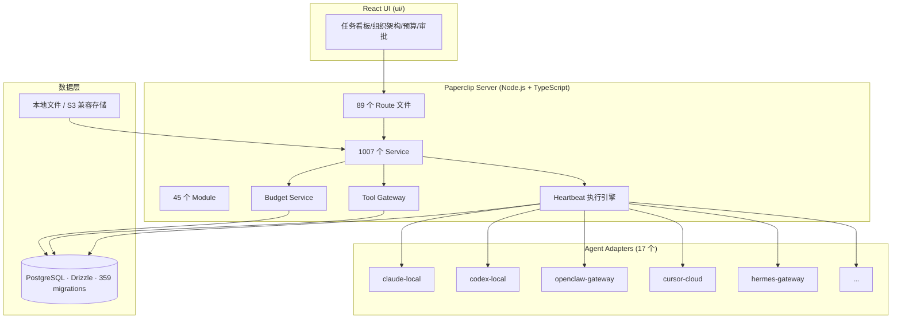
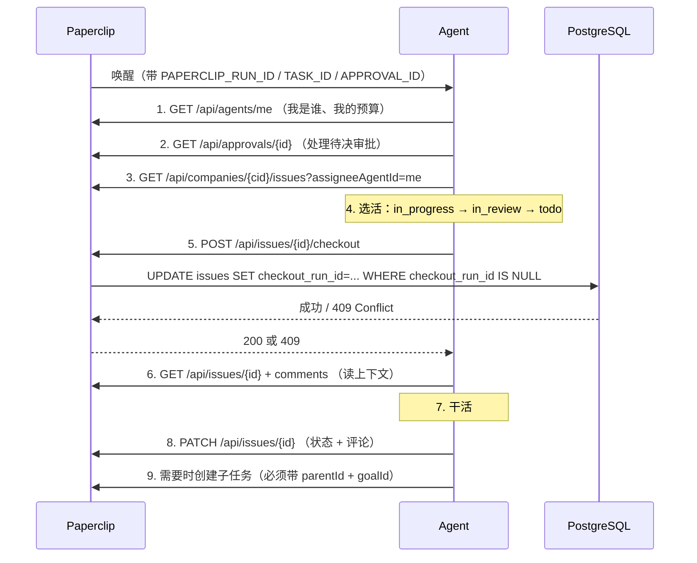

## 一句话：如果 OpenClaw 是员工，Paperclip 想当公司

> "If OpenClaw is an *employee*, Paperclip is the *company*."

这是 README 里最锋利的一句话，也是理解整个项目的钥匙。

过去两年，AI 编程 Agent 的形态已经很清楚了：Claude Code、Codex、Gemini CLI、OpenClaw——它们本质上是**单个执行者**，一次会话干完一件事。但当你想让 20 个 Agent 同时干活时，问题立刻从"模型能力"变成了"管理问题"：谁在干什么？谁卡住了？花了多少钱？谁批准了这次部署？

Paperclip 的判断是：**这不该用更多 Prompt 解决，而该用组织架构解决**。于是它把软件开发里的那套东西——工单、签出、审批、预算、绩效、审计日志——原封不动搬到了 Agent 身上。

这也解释了它为什么长得像个任务管理器，而不像个 Agent 框架。

## 项目速览

| 项目 | 信息 |
|------|------|
| 定位 | 开源 AI Agent 团队编排控制面（Control Plane） |
| Stars | 103.9k |
| Forks | 17.4k |
| 许可证 | MIT |
| 主要语言 | TypeScript（7,573 个 .ts/.tsx 文件） |
| 创建时间 | 2026-03-02 |
| 最新提交 | 2026-10-18（当天仍有 30+ 次提交） |
| 最新发布 | v2026.1012.0（2026-10-12） |
| CLI 版本 | `paperclipai@0.3.1` |
| 提交数 | 4,775+ Commits |
| 贡献者 | 约 317 人，5196 次提交集中在主贡献者 |
| 数据库 | 内嵌 PostgreSQL（Drizzle ORM，359 个迁移文件） |
| 总仓库体积 | 385 MB |

**一句话判断：** 如果你在跑多个 Agent 且已经开始"记不住谁在干什么"，这是目前最完整的一套现成方案；如果你只有一个 Agent，它是过度工程。

> **信息来源：** GitHub API（`/repos/paperclipai/paperclip`、`/releases`、`/contributors`）、`cli/package.json`、仓库 `git ls-tree` 统计

## 为什么存在：Agent 编排的"最后一公里"是管理问题

### 痛点不是能力，是协调

当一个人同时开 20 个 Claude Code 终端时，真正的痛苦不是"模型不够聪明"，而是这些：

| 没有 Paperclip 时的现实 | Paperclip 的答案 |
|---|---|
| 20 个终端窗口，重启后上下文全丢 | 工单化 + 线程化对话 + 会话持久化 |
| 每次都要手动把背景塞给 Agent | 上下文从任务 → 项目 → 公司目标逐级继承 |
| Agent 之间互相覆盖同一份文件 | **原子签出**（checkout），一个任务只有一个执行者 |
| 半夜跑飞，早上发现烧了几百刀 | 预算策略 + 硬停 + 预留额度 |
| 重复任务靠人记 | Routines：cron / webhook / API 触发 |
| 出了问题查不到是谁干的 | 全链路 Activity Log + 归因到"责任人" |

### 核心洞察：Agent 缺的不是智能，是**问责结构**

Paperclip 真正解决的问题，是让 Agent 从"能干活"变成"**可管理**"：

- Agent 有**角色、职级、汇报线**
- 任务有**签出锁**，不会两个 Agent 抢同一件事
- 花钱有**预算封顶**，不是靠自觉
- 高风险操作有**审批闸门**，不是靠 Prompt 劝

这个思路的代价也很明确：你要接受一套"公司"的心智模型。项目管理本来就是重活，把 Agent 套进去，摩擦不会消失，只会转移到配置上。

> **信息来源：** README "Problems Paperclip solves" 章节、"The four pillars" 章节

## 架构与设计

### 整体结构



架构上有个细节值得注意：**Service 层有 1007 个文件**，而 Route 只有 89 个。这说明它的复杂度几乎全部集中在业务逻辑而非 HTTP 层——这不是一个"API 薄壳"，而是一个真正的控制面。

### 核心模块一：Heartbeat 协议——Agent 与平台的唯一契约

Paperclip 对 Agent 的定义极其克制：**"只要能接收 heartbeat，就能被雇佣"**。

所谓 heartbeat，就是 Agent 被唤醒后执行的一套固定流程。文档 `docs/guides/agent-developer/heartbeat-protocol.md` 把它写成了 9 个步骤：



这里藏着一个非常关键的设计决策：**409 是不可重试的**。

协议明文写着：

> If another agent owns it: `409 Conflict` — stop and pick a different task. **Never retry a 409.**

这句话背后是对分布式系统的清醒认知。在多 Agent 并发场景里，"重试"是最容易写出死锁和雪崩的操作。Paperclip 直接把冲突定义成**终止条件**而不是**可重试错误**，逼 Agent 改去干别的活。这种"把并发问题设计成不可重试"的思路，比任何退避算法都更抗压。

### 核心模块二：原子签出——同一任务只有一个执行者

心跳协议的第 5 步对应服务端 `server/src/services/issues.ts` 里的签出逻辑。剥掉业务分支后，核心是一个**带条件的 UPDATE**：

```ts
const updated = await db
  .update(issues)
  .set({
    assigneeAgentId: agentId,
    checkoutRunId,
    executionRunId: checkoutRunId,
    executionLockedAt: now,
    status: "in_progress",
  })
  .where(
    and(
      eq(issues.id, id),
      inArray(issues.status, expectedStatuses),   // 状态守卫
      eq(issues.checkoutRunId, current.checkoutRunId), // 乐观锁守卫
      or(
        isNull(issues.assigneeAgentId),
        eq(issues.assigneeAgentId, agentId),
      ),
    ),
  )
  .returning()
  .then((rows) => rows[0] ?? null);
```

这是典型的**乐观并发控制**：不靠应用层加锁，而是把"期望状态"写进 `WHERE` 子句。如果并发竞争者先一步改了行，`WHERE` 不匹配、`returning()` 拿到 `null`，直接 `throw conflict("Issue checkout conflict")`。

数据库层还有一道兜底——`issues` 表上有 `checkout_run_id` 和 `execution_run_id` 两个自引用外键，都指向 `heartbeat_runs`：

```ts
checkoutRunId: uuid("checkout_run_id").references(() => heartbeatRuns.id, { onDelete: "set null" }),
executionRunId: uuid("execution_run_id").references(() => heartbeatRuns.id, { onDelete: "set null" }),
executionLockedAt: timestamp("execution_locked_at", { withTimezone: true }),
```

这种设计让"锁"本身成了**外键完整性的一部分**：如果持有锁的那次 run 记录被删，锁自动置空。不需要定时扫表清理僵尸锁。

但光有原子性还不够。系统还得处理"锁的持有者已经死了"这种情况。于是有了 `TERMINAL_HEARTBEAT_RUN_STATUSES`：

```ts
export const TERMINAL_HEARTBEAT_RUN_STATUSES = new Set([
  "succeeded", "interrupted", "failed", "cancelled", "timed_out",
]);
```

签出时如果发现 `executionRunId` 指向一个已经终态的 run，代码会走"僵尸锁收养"路径——在同一个事务里 `SELECT ... FOR UPDATE` 锁定 issue 行和两个 run 行，确认旧 run 确实终态后，把锁改判给当前 run：

```ts
const stale = !existingRun || TERMINAL_HEARTBEAT_RUN_STATUSES.has(existingRun.status);
const actorLive = actorRun && !TERMINAL_HEARTBEAT_RUN_STATUSES.has(actorRun.status);
if (!stale || !actorLive) return { adopted: null, latest: lockedIssue };

const adopted = await tx.update(issues).set({
  checkoutRunId: input.actorRunId,
  executionRunId: input.actorRunId,
  executionLockedAt: now,
}).where(and(
  eq(issues.id, input.issueId),
  eq(issues.status, "in_progress"),
  eq(issues.assigneeAgentId, input.actorAgentId),
  eq(issues.checkoutRunId, input.expectedCheckoutRunId),
)).returning().then(rows => rows[0] ?? null);
```

**值得学习的一处细节：** 收养逻辑同时要求"旧 run 已死"**且**"新 run 活着"（`!stale || !actorLive` 才放弃）。少了后者，一个即将退出的 run 可能抢走一个刚死的 run 的锁，然后自己也退出，锁再次变成僵尸。这种双向存活检查在写恢复逻辑时很容易漏掉。

### 核心模块三：预算预留——在派发之前就把钱锁住

只做事后记账的预算系统，在 Agent 场景下基本没用——`claude` 一次长跑能烧掉几十美元，等你记完账，钱已经花了。

`server/src/services/budget-reservations.ts` 的解法是**派发前预留（reserve before dispatch）**，注释写得很直白：

> Reserve before dispatch, under the same company lock as charges and policy changes. Estimates constrain admission; they cannot cap a provider's bill. A reservation survives timeouts and restarts until accounting proves closure.

核心逻辑是在同一个 `withAccountingTransaction` 里做三件事：读 run 行加锁、算已持有预留、判断容量。

```ts
const committed = centsToUnits(observed.totalExact) + centsToUnits(held.amount);
const limit = centsToUnits(policy.amount);
if (committed >= limit || committed + amount > limit) {
  throw conflict("Available budget is reserved by unfinished runs");
}
```

注意用的是**精确的整数分（cents as string → BigInt）**，不是浮点数。金额计算用 `bigint` 而不是 `number`，这是金融类系统的基本功，很多项目在这里栽跟头。

还有一处防重派发的小技巧：

```ts
// A zero-valued row also fences duplicate dispatch when estimates are off.
```

即使估算值为 0，也写一行预留记录——这行的作用不是占钱，而是当**幂等栅栏**：第二次派发尝试会发现已有预留，直接 `throw conflict("Provider dispatch has already reserved this run")`。

**性能设计要点：** 整个预留过程在一个事务里做，且用公司级锁。这意味着同一个公司内部的 Agent 派发是**串行化**的。对单个公司来说是性能瓶颈，但换来了"绝不多花一分钱"的强保证——这是一次清晰的取舍，不是疏忽。

> **信息来源：** `server/src/services/budget-reservations.ts`、`server/src/services/budgets.ts`

### 核心模块四：存活分类器——让 Agent 的"我很忙"变得可测量

这是我认为整个项目最有创意的一块。

Agent 最常见的失败模式不是崩溃，而是**"看起来在干活，其实什么都没做"**——回一段计划、说一句"我接下来会检查 X"，然后退出。人类看不出问题，因为输出来得像模像样。

`server/src/services/run-liveness.ts` 用一个纯函数把这种情况量化了。判据非常实在——**不看 Agent 说了什么，只看产生了哪些持久化证据**：

```ts
export function hasConcreteActionEvidence(evidence) {
  const normalized = normalizeEvidence(evidence);
  // Workspace creation is setup evidence, not task progress by itself.
  return (
    normalized.issueCommentsCreated +
      normalized.documentRevisionsCreated +
      normalized.workProductsCreated +
      normalized.activityEventsCreated +
      normalized.toolOrActionEventsCreated >
    0
  );
}
```

然后是分类主流程，本质是一棵优先级判定树：

```ts
export function classifyRunLiveness(input) {
  // ... 前置：run 状态、issue 状态
  if (issueStatus === "done" || issueStatus === "cancelled")
    return output("completed", `Issue is ${issueStatus}`);

  if (declaredBlocker(input))
    return output("blocked", ..., nextAction);

  if (!usefulOutput && !concreteEvidence)
    return output("empty_response", "Run succeeded without useful output or concrete action evidence");

  if (concreteEvidence)
    return output("advanced", `Run produced concrete action evidence: ...`);

  if (planExempt && usefulOutput)
    return output("advanced", "Explicit planning mode ... exempt");

  if (looksLikePlanningOnly(input) || nextAction) {
    if (actionability === "runnable")
      return output("plan_only", "Run described runnable future work without concrete action evidence", nextAction);
    return output("needs_followup", "Run described future work that is not safe to auto-continue", nextAction);
  }
  return output("needs_followup", "Run produced useful output but no concrete action evidence", nextAction);
}
```

有意思的细节是"计划模式豁免"：

```ts
// This is a diagnostic only. Requested deliverables (including plans) do not
// select a work mode; only the persisted field grants the planning exemption.
const planExempt = input.issue?.workMode === "planning" || evidence.planDocumentRevisionsCreated > 0;
```

只有**持久化的 `workMode === "planning"`** 或**已保存的 plan 文档修订**才算豁免。Agent 自己在输出里写一句"这个任务需要先做计划"不算数。这堵死了 Agent 自我豁免的口子。

分类结果怎么用？`plan_only` 和 `empty_response` 会触发**有界续跑**：

```ts
const ACTIONABLE_LIVENESS_STATES = new Set(["plan_only", "empty_response"]);
export const DEFAULT_MAX_LIVENESS_CONTINUATION_ATTEMPTS = 2;
```

最多继续 2 次，每次的幂等键由 `(issueId, sourceRunId, livenessState, attempt)` 组成，保证不会重复入队。两次之后如果还是没产出，就留下一条审计评论交给人处理，而不是无限烧钱：

```text
Bounded liveness continuation exhausted
- Last liveness state: `plan_only`
- Attempts used: 2/2
- Next action: a human or manager should inspect the run and either clarify the task, mark it blocked, or assign a concrete follow-up.
```

**这是整个项目里最值得抄的一个模式：** 把"Agent 是否真在进步"从主观感觉变成了可计算的状态机，并且续跑次数有硬上限。

> **信息来源：** `server/src/services/run-liveness.ts`、`server/src/services/recovery/run-liveness-continuations.ts`

### 核心模块五：OpenClaw 适配器——WebSocket 上的会话路由

既然本文从 OpenClaw 说起，最后看一个具体适配器怎么接。`packages/adapters/openclaw-gateway/src/server/execute.ts`（1536 行）走的是 Gateway WebSocket 协议，而不是 HTTP `/v1/responses`。

最巧的是会话键的映射策略：

```ts
export function resolveSessionKey(input: {
  strategy: SessionKeyStrategy;  // "issue" | "fixed" | "run"
  configuredSessionKey: string | null;
  agentId: string | null;
  runId: string;
  issueId: string | null;
}): string {
  const fallback = input.configuredSessionKey ?? "paperclip";
  if (input.strategy === "run") {
    return prefixSessionKeyForAgent(`paperclip:run:${input.runId}`, input.agentId);
  }
  if (input.strategy === "issue" && input.issueId) {
    return prefixSessionKeyForAgent(`paperclip:issue:${input.issueId}`, input.agentId);
  }
  return prefixSessionKeyForAgent(fallback, input.agentId);
}
```

默认策略是 `"issue"`——**一个任务 = 一个长期会话**。这意味着同一个任务上多次唤醒会复用同一个 OpenClaw 会话，上下文自然延续；不同任务则完全隔离，互不污染。这个映射关系非常符合直觉，但很多编排系统在这里处理得很糙（要么全共用，要么全新建）。

调用侧是两段式的：`agent` 方法接收任务，如果返回非 `ok` 状态，再用 `agent.wait` 阻塞等待结果：

```ts
reportDispatch();
const acceptedPayload = await client.request("agent", agentParams, { timeoutMs: connectTimeoutMs });
// ...
if (acceptedStatus !== "ok") {
  const waitPayload = await client.request(
    "agent.wait",
    { runId: acceptedRunId, timeoutMs: waitTimeoutMs },
    { timeoutMs: waitTimeoutMs + connectTimeoutMs },
  );
  // ...
}
```

代码里有一条注释说明了为什么要把 `reportDispatch()` 放在这个位置：

> The first agent request is the remote-work boundary: once it is sent, retrying would be unsafe because the gateway may have accepted work even if the response is lost.

**又是一个"什么时候不许重试"的边界判断。** 这里的判断依据不是"网络有没有失败"，而是"对方有没有可能已经开始干活"。这类思考在分布式系统里极其重要，但非常容易被忽略。

另外注意 `SENSITIVE_LOG_KEY_PATTERN`：

```ts
const SENSITIVE_LOG_KEY_PATTERN =
  /(^|[_-])(auth|authorization|token|secret|password|api[_-]?key|private[_-]?key)([_-]|$)|^x-openclaw-(auth|token)$/i;
```

有专门的脱敏正则在写日志前过滤敏感字段。这是"考虑到会有人把日志发给别人"的工程意识。

> **信息来源：** `packages/adapters/openclaw-gateway/src/server/execute.ts`、`src/index.ts`

## 快速上手

### 安装（需 Node.js 24.11+）

```bash
npx paperclipai@latest onboard --yes
```

如果用了私有 npm registry 导致 `E404`：

```bash
npx --registry https://registry.npmjs.org paperclipai@latest onboard --yes
```

### 只想试一下，不想装服务

```bash
# 用 Anthropic 的 key，拉起一个已初始化 CEO Agent 的临时实例
ANTHROPIC_API_KEY=sk-ant-xxx npx paperclipai test-drive

# 或者用 Codex harness
OPENAI_API_KEY=sk-xxx npx paperclipai test-drive --harness codex

# 指定 provider 和模型
OPENROUTER_API_KEY=sk-or-xxx npx paperclipai test-drive \
  --harness opencode \
  --model openrouter/anthropic/claude-sonnet-4.5
```

`test-drive` 有几个贴心设计：每次运行（不带 `--data-dir`）都会用一个**唯一且保留**的临时目录，启动时打印绝对路径；`--no-browser` 可以不自动开浏览器。

### 源码开发

```bash
pnpm i
pnpm dev          # API + UI，watch 模式
pnpm dev:mobile   # 手机/平板访问（:3101 代理到 :3100）
pnpm typecheck
pnpm test         # Vitest
```

源码构建同时会编译原生 Paperclip Runner（Rust），需要 Rust 工具链，或者设 `PAPERCLIP_RUNNER_BINARY` 指向预编译二进制。

### 常见配置项

| 变量 | 作用 |
|---|---|
| `PAPERCLIP_RUNNER_BINARY` | 指定预编译的 Runner，跳过 Rust 构建 |
| `PAPERCLIP_TELEMETRY_DISABLED=1` | 关闭匿名遥测（也支持标准 `DO_NOT_TRACK=1`） |
| `OTEL_EXPORTER_OTLP_ENDPOINT` | 开启 OpenTelemetry trace（仅 trace） |
| `SENTRY_DSN_BACKEND` / `SENTRY_DSN_FRONTEND` | 分别开启服务端/浏览器错误监控 |

默认监听 `http://localhost:3100`，自动创建内嵌 PostgreSQL，不需要任何数据库配置。

### 一个完整的心跳调用示例

如果自己写 Agent 接入，最小可运行的心跳循环长这样（伪代码，对应协议 Step 1/3/5/8）：

```ts
const BASE = process.env.PAPERCLIP_API_URL!;
const KEY = process.env.PAPERCLIP_API_KEY!;
const RUN_ID = process.env.PAPERCLIP_RUN_ID!;

const api = (path: string, init: RequestInit = {}) =>
  fetch(`${BASE}${path}`, {
    ...init,
    headers: {
      Authorization: `Bearer ${KEY}`,
      "Content-Type": "application/json",
      "X-Paperclip-Run-Id": RUN_ID,
      ...init.headers,
    },
  });

// Step 1: 我是谁
const me = await api("/api/agents/me").then((r) => r.json());

// Step 3: 我的收件箱
const issues = await api(
  `/api/companies/${me.companyId}/issues?assigneeAgentId=${me.id}` +
    `&status=todo,in_progress,in_review,blocked`,
).then((r) => r.json());

// Step 5: 签出（409 就换一个，绝不重试）
const picked = issues[0];
const res = await api(`/api/issues/${picked.id}/checkout`, {
  method: "POST",
  body: JSON.stringify({
    agentId: me.id,
    expectedStatuses: ["todo", "backlog", "blocked", "in_review"],
  }),
});

if (res.status === 409) {
  console.log("被别人抢了，换一个");
} else {
  const issue = await res.json();

  // Step 7: 干活...

  // Step 8: 更新状态
  await api(`/api/issues/${issue.id}`, {
    method: "PATCH",
    body: JSON.stringify({
      status: "done",
      comment: "改完了 X，验证方式是 Y。",
    }),
  });
}
```

> **信息来源：** `docs/guides/agent-developer/heartbeat-protocol.md`、README Quickstart 章节

真实接入时还要注意：**每次 heartbeat 结束前必须在 issue 上留 comment**，这是协议硬性要求（"Always comment on in-progress work before exiting a heartbeat"）。如果只想加载数据到自己的程序里，建议从 `test-drive --data-dir` 起步，避免污染正式实例。

## 横向对比

Agent 编排这个赛道现在很挤，但各家定位差异其实非常明显。

| 维度 | Paperclip | OpenClaw | Claude Code | CrewAI / LangGraph |
|---|---|---|---|---|
| 定位 | Agent 团队的**公司管理**系统 | 单个常驻 Agent 员工 | 单体编程 Agent CLI | 代码级 Agent 编排框架 |
| 抽象层 | 组织 / 工单 / 预算 / 审批 | 会话 / 技能 / 定时任务 | 一次任务会话 | Agent / Task / Graph |
| 学习曲线 | 陡（要理解一整套组织模型） | 中 | 低 | 中（要写 Python） |
| 并发模型 | 每任务原子签出 + 心跳队列 | 单 Agent 消息队列 | 单进程 | 框架自定义 |
| 成本控制 | 派发前预留 + 阈值告警 + 硬停 | 无内建 | 按订阅/API 计费 | 需自行实现 |
| 生态/适配 | 17 个 adapter（Claude/Codex/OpenClaw/Cursor…） | 内置工具 + 插件 | 单一 harness | 生态庞大但需自己搭 |
| 部署形态 | 自托管 Node + PG / Docker / Cloud | 自托管 | 本地 CLI | 库，随你的应用部署 |
| 维护活跃度 | 极高（日均 30+ 提交，359 个迁移） | 高 | 高（闭源迭代） | 中高 |

**关键差异：** 这四者不是竞争关系，是**分层关系**。Claude Code 是执行器，OpenClaw 是常驻员工，CrewAI/LangGraph 是编排库，Paperclip 是管理这些执行器的**控制面**。它甚至直接支持把 OpenClaw 当员工接进来（`openclaw_gateway` adapter）。

真正的对比对象其实是：**自己用 Jira/Linear + 一堆脚本硬凑**。Paperclip 的赌注是——你会愿意为省下这套协调代码而接受它的组织模型。

> **信息来源：** 各项目官方 README；Paperclip `packages/adapters/` 目录、README "Why Paperclip is special / What Paperclip is not" 章节

## 使用建议与风险评估

### ✅ 推荐场景

- **多 Agent 并行**：3 个以上 Agent 同时干活，已经出现"谁在做什么"的混乱
- **需要成本闸门**：订阅制 API / 云模型，怕跑飞烧钱
- **需要审计**：合规场景，要能回答"这次部署是谁批准的"
- **非程序员团队**：需要"任务管理器"式交互，而不是命令行
- **定期自动化**：报表、客服、内容发布这类固定流程

### ❌ 不推荐场景

- **单 Agent 日常使用**：你会为 1007 个 service 文件付出你不需要的复杂度
- **追求极简**：如果你觉得 Git + 一个 cron 就够了，别碰
- **对延迟敏感**：公司级串行锁在派发路径上，高并发下有排队
- **不想学组织模型**：这不是装上就能用的工具，需要设计角色和权限

### ⚠️ 已知风险（基于当前 open issues）

**1. 审查交接可能静默卡死（#13532，仍在 open）**

两 Agent 的 review handoff 场景下，如果前一次执行还没释放环境租约，跳过的唤醒是**终态**——不重试、不升级、不通知。Issue 会一直停在 `in_review`，直到人手动唤醒。这对"全自动 24/7"的承诺是个硬伤。

**2. 订阅制认证 token 不刷新（#14182，open）**

Anthropic 订阅连接约 8 小时后失效，因为只存了短期 access token 且不刷新。表现是每隔 8 小时就得手动重连一次。用 API key 而非订阅的话不受影响。

**3. 高频迭代 = 迁移风险**

9 个月 359 个数据库迁移文件，平均每天 1.3 个。这种迭代速度意味着**升级前必须备份**，且要有回滚路径。项目自己也提供了 `scripts/backup-db.sh`。

**4. 版本号两套体系**

CLI 是 `0.3.1`，服务端是 `v2026.1012.0`（日历版本）。升级时别搞混。

**5. 仓库体积 385 MB，6128 个 open issue**

Issue 数量本身说明使用基数大，但也意味着你遇到的坑多半已经有人踩过——先去 issue 搜再动手。

### 🔮 未来展望

Roadmap 上还剩几个大块没做完：

- 🟡 **Memory / Knowledge**——目前 Agent 记忆靠任务上下文，没有长期知识库
- 🟡 **Agent Chat**——实验性，想做到"聊天里派活"
- ⚪ **MAXIMIZER MODE**、**Work Queues**、**Self-Organization**、**Automatic Organizational Learning**——这几个名字听着野心很大，全是未开始状态

开源 + MIT + 日均 30 提交，短期内没有跑路的迹象。但"自主组织"这类能力如果真做出来，产品定位会从"管理器"变成某种意义上的"公司大脑"，那时防跑偏的设计（预算硬停、审批闸门、存活分类器）会变得比现在战略意义高得多。

> **信息来源：** GitHub Issues #13532 / #14182 / #14093（标题、状态、描述）、README Roadmap 章节

## 总结

**三个核心 takeaway：**

1. **Agent 编排的瓶颈是管理而非智能。** Paperclip 把工单、签出锁、预算、审批、审计做成了一等公民。这套"公司隐喻"不是营销话术，而是整份代码库的组织原则——1007 个 service 文件几乎都在服务这个模型。

2. **真正值得抄的是它对"什么时候不许重试"的判断。** 409 冲突不可重试、dispatch 后不可重试、僵尸锁收养要求双向存活检查、存活继续最多 2 次——这些边界定义比任何重试策略都更能防止系统雪崩。分布式系统的成熟度，往往体现在它拒绝做什么。

3. **"Agent 到底有没有干活"可以被量化。** `classifyRunLiveness` 用持久化证据（评论/文档修订/工具事件计数）而非自然语言输出来判断进步，并给自动续跑设了硬上限。这个模式适用于任何需要判断 AI 是否"假装在工作"的系统。

**一句话推荐：**

如果你已经在跑 3 个以上 AI Agent 并且开始感到管理混乱——去试试 `npx paperclipai test-drive`，它会在几分钟内给你一个能跑起来的实例。如果你只有一个 Agent，留着这篇当架构笔记就行，里面有几个设计模式值得借。

---

**版本与来源说明：** 本文基于仓库 `master` 分支 commit `c9669a6`（2026-10-18）与 CLI `paperclipai@0.3.1` 撰写。源码引用均来自该 commit；Star/Fork/Issue 数据取自 GitHub API（2026-10-18）。工程细节未做主观臆测，所有判据均可在对应文件内检索验证。
